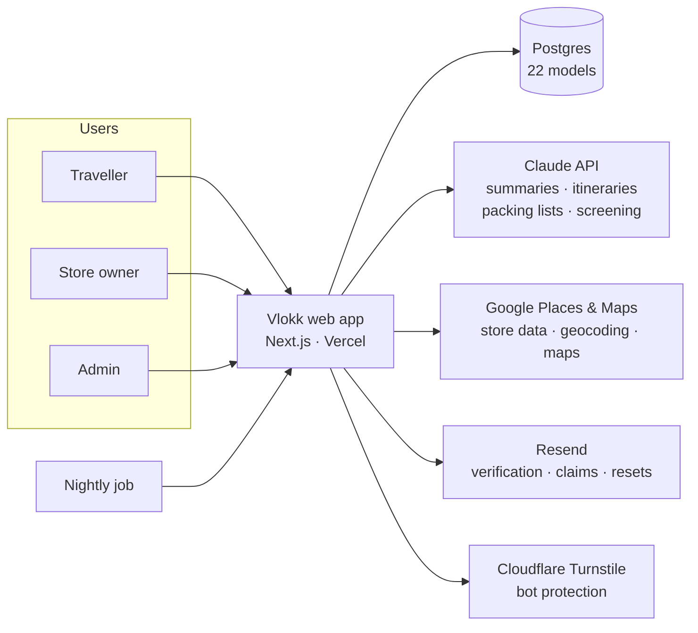
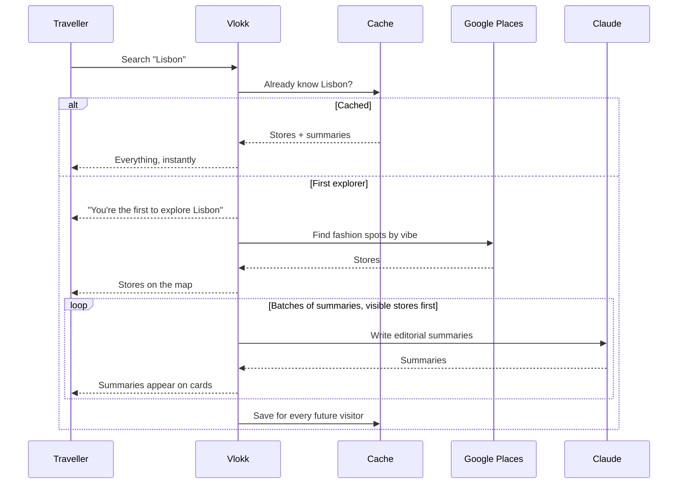
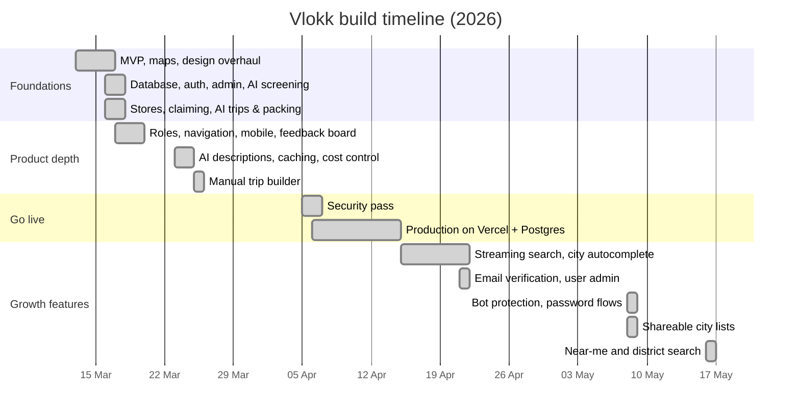

# Vlokk

### Find the independent fashion spots worth travelling for.

Boutiques, vintage shops, concept stores and markets in any city, with AI-planned shopping itineraries and packing lists.

**[🌐 Visit vlokk.com](https://www.vlokk.com/)** · Product Manager & AI-native builder · Source code is private, happy to walk through it live

<!-- Screenshots: add 3–4 here, e.g.

  
  
  

-->

---

## At a glance

| ⏱️ 9 weeks | 🔁 258 commits | 🧩 55 API endpoints | 📱 37 screens |
|:---:|:---:|:---:|:---:|
| **🗃️ 22 data models** | **👥 3 user roles** | **🤖 5 AI features · 8 integrations** | **📝 ~25k lines of TypeScript** |

From first commit to a production deployment with real auth, an admin console, a store-owner portal, and AI and live Google data throughout. Built by one person, vibe coding with Claude Code.

---

## 🤖 AI & integrations

Vlokk is built around two core integrations, the **Claude API** and the **Google Places API**, plus a set of supporting services. Each one does a specific job in the product.

### 🧠 Claude API — five AI features, two models

I matched each task to the right model: a fast, low-cost model for quick decisions and a stronger model for writing and planning.

| Feature | What the AI does | Model tier |
|---|---|---|
| ✍️ **Store summaries** | Writes a two-sentence editorial description of every store in a "Vogue travel editor" voice, grounded in real customer reviews and the store's own website | Stronger |
| 🗺️ **Shopping itineraries** | Plans a day-by-day shopping trip from a city, trip length and chosen vibes, using Vlokk's own stores | Stronger |
| 🧳 **Packing lists** | Builds a categorised packing list for the destination, trip length and style | Stronger |
| 🛡️ **Submission screening** | Checks community-suggested spots against Vlokk's rules (independent, fashion-focused, no chains) before a human sees them | Fast |
| 🧭 **Route optimisation** | Re-orders a hand-built day plan into a sensible walking route | Fast |

**What makes it production-ready, not a demo:** output is validated before it's used, calls have timeouts and fallbacks, requests are batched and de-duplicated, every AI endpoint is rate-limited, and generated summaries are stored so each one is only paid for once.

### 📍 Google Maps Platform — the live data behind every search

| API | How Vlokk uses it |
|---|---|
| **Places API (Text Search)** | Finds stores for each vibe in a city, requesting only the fields needed to keep costs down, then filters out chains and big-brand flagships |
| **Places API (location-biased search)** | Powers "near me" and district search, with Vlokk measuring real distances to keep results within a walkable radius |
| **Place Details** | Pulls ratings, reviews, website and Maps links for each store |
| **Places Autocomplete** | City, district and address suggestions as you type, run on the server so the API key never reaches the browser |
| **Geocoding** | Turns a city name into a map centre, and a location back into a neighbourhood name |
| **Maps JavaScript API** | A custom dark-styled map with Vlokk's own pins, Google's icons dimmed into the background |

### 🔌 Supporting services

| Service | Role |
|---|---|
| **Auth.js** | Sign-in, sessions and three user roles |
| **Postgres (Neon) + Prisma** | 22-model database, with a local-to-production switch requiring no code changes |
| **Resend** | Verification, password reset and store-claim emails |
| **Cloudflare Turnstile** | Bot protection on sign-up |
| **Vercel** | Hosting, deployments and a nightly clean-up job |

---

## The problem

Before every trip I'd spend hours scrolling TikTok and dropping pins on Google Maps to find good independent fashion stores. Travel guides cover restaurants and sights; nothing is built for people who travel to shop. The information exists, but it's scattered, unverified and goes stale fast.

## The product

Vlokk is a marketplace-shaped product with four groups to serve:

| Who | What they get |
|---|---|
| 🧳 **Travellers** | Search a city or "near me", filter by vibe (vintage, streetwear, luxury, local designers, concept stores, markets), explore on a map, and read a short editorial summary of each store. Plan a day-by-day shopping trip and get a packing list. |
| 💬 **Community** | Save, rate and annotate spots, follow stores, suggest new spots, build and share city lists, and vote on what gets built next. |
| 🏬 **Store owners** | Claim their page from an emailed link, then post events and sales and see their reviews. |
| 🛠️ **Admins** | Moderate submissions and reviews, manage users and roles, pin must-see stores into results, and track claims. |

---

## Product decisions

The calls that shaped Vlokk, and the reasoning behind each.

**🔓 Value before sign-up.** Search and discovery need no account. The sign-up prompt appears only when someone tries a gated action, and even then it waits until they've filled in the form, so their effort is never lost.

**🌱 Supply that grows itself.** When a new spot is approved, the owner automatically gets a one-time, 7-day link to claim their page. Store owners are recruited by the product, not by outreach.

**🤖 AI as the first moderator.** Community suggestions are screened by AI against Vlokk's criteria (for example, no chain stores) before a human sees them. The admin queue only holds plausible spots, and the screening log shows where the criteria need tuning.

**💸 Right-sized AI for every job.** A fast, low-cost model handles yes/no screening; a stronger model writes summaries, itineraries and packing lists. Cost was a design input from day one.

**📦 Trips export as a file, not a link.** An itinerary downloads as a self-contained page with Google Maps directions for each day. It's useful offline, and it brings people back to Vlokk rather than giving the core value away on a public URL.

**📈 Monetisation ready, not switched on.** Usage is already counted per user, so a subscription limit can be turned on with no data changes. Launch, learn, then charge.

---

## Under the hood

### How it fits together

### ⚡ Results that stream in, not a loading spinner

The first search for a new city means fetching dozens of stores from Google and writing an AI summary for each. Rather than make people wait for all of it, the city page opens a live stream and fills in as work completes:

### 🗄️ Three-layer cache, tuned to how the data actually behaves

Store data is served from **memory → database → live fetch**, in that order. A boutique's character rarely changes, so city data is kept for a year and AI summaries for two. The first visitor to a city pays the cost; everyone after gets an instant page, and API spend stays flat as traffic grows.

### 🤖 Making AI reliable at scale

- **Batching and prioritising.** Summaries are generated in small batches, with the stores on screen done first.
- **No duplicate work.** If two people search the same city at once, they share one in-flight request instead of triggering two.
- **Graceful fallback.** If AI is slow or unavailable, a sensible default description is shown and the page still works.
- **Grounded output.** Summaries are informed by real customer reviews, rewritten in Vlokk's editorial voice rather than quoted.

### 📍 "Near me" that finds the good stuff

Strict location filters made Google miss great stores just outside the boundary. Vlokk asks Google to *prefer* results near the user, then measures the real distance to each store itself and keeps only those within the chosen radius. Searches can also target a district, defaulting to a walkable 2 km.

### 🔐 Auth, roles and trust

- **Three roles** (traveller, store owner, admin), each with its own navigation and dashboards. Access is checked on the server for every protected page.
- **Lightweight edge gate.** A fast pre-check redirects logged-out users before a page loads, without loading the full auth library at the edge.
- **Account lifecycle.** Email verification, password reset, and account deletion with a 30-day grace period. A nightly job permanently removes expired and never-verified accounts.
- **Bot and abuse protection.** Cloudflare Turnstile, a hidden honeypot field and rate limits on sign-up; rate limits on every AI and Google endpoint.

### 🧱 Built to move fast without breaking things

- Developed locally on SQLite, switched to hosted Postgres for production with no application code changes.
- A custom pre-push check blocks any change that would accidentally delete database fields, a guard against a real mistake made while working across parallel branches.

---

## How it evolved

Nine weeks, 258 commits, shipped in focused bursts.

| When | Milestone | What changed |
|---|---|---|
| **Day 1** | 🚀 Working MVP | City search with live Google data on a map. Swapped Mapbox for styled Google Maps the same day after fighting map centring issues. |
| **Week 1** | 🏗️ A real platform | Accounts and three roles, admin console, AI-screened submissions, store pages and claiming, AI itineraries and packing lists, mobile layout. |
| **Week 2** | 💸 Quality and cost | Unique AI descriptions from real reviews. Hit AI rate limits under load and fixed it with batching, de-duplication and caching. Manual trip builder with route optimisation. |
| **Weeks 3–5** | 🌍 Going live | Pre-launch security review. Moved to Vercel and hosted Postgres; worked through framework and runtime compatibility issues to get a stable production build. |
| **Weeks 5–6** | ⚡ Speed and control | Results stream in progressively. City and store-name autocomplete. Admin tool to pin standout stores. Concept stores added as a vibe. Email verification. |
| **Weeks 7–9** | 🤝 Social and local | Bot protection, password flows, shareable city lists with analytics, near-me and district search, and a round of mobile polish. |

### Problems worth solving along the way

- **The map was too busy.** Google's own business icons competed with Vlokk's pins. Five rounds of tuning later, they sit quietly in the background and Vlokk's pins are the only colour on the map.
- **AI costs and limits.** Generating summaries for a whole city at once hit API limits. Batching, sharing in-flight requests and long-lived caching fixed reliability and cut cost.
- **Saved spots that weren't saved.** Hearts showed as saved even when the save failed. Traced to the root cause: the app recorded the save locally *before* the server confirmed it. Now it only shows once it's real.
- **Production is not localhost.** The move to hosting surfaced database, framework and runtime issues that never showed up locally. Each was fixed at the source, and a guard was added so one class of mistake can't recur.

---

## What's next

1. **🚀 Launch** at vlokk.com and get it in front of real travellers.
2. **🎨 My Style** — a personal style profile built from someone's Pinterest boards.
3. **👗 My Wardrobe** — a digital closet that spots gaps and feeds packing lists.
4. **🔗 Wardrobe meets map** — "You want a structured blazer; this Berlin store stocks exactly that."
5. **📲 Native app** on the same backend, plus a paid tier for unlimited trips and style features.

The data models for My Style and My Wardrobe are already in place.

---

## How I built it: vibe coding, with a PM's judgement

Vlokk was built entirely through AI-assisted development, with **Claude Code** as my engineering partner. I describe what I want, review what comes back, test it, and steer until it's right. 258 commits in 9 weeks.

Vibe coding gets you a demo quickly. Getting to production takes judgement, and that part was mine:

- **Deciding what to build** — the problem, the users, the roles, the flows and the trade-offs above.
- **Choosing the right tools** — which APIs to integrate, which AI model fits each job, and where caching pays off.
- **Debugging to the root cause** — rate limits, broken saves, production-only failures, traced and fixed properly rather than patched.
- **Knowing when it's done** — security review, abuse protection and cost controls before launch.

The result is a production-grade app with two major API integrations, five AI features and three user roles, the kind of build that would usually take a small team.

---

**Tamzyn Eady** · Product Manager

[LinkedIn](https://www.linkedin.com/in/tamzyneady/) · tamzyneady@gmail.com

